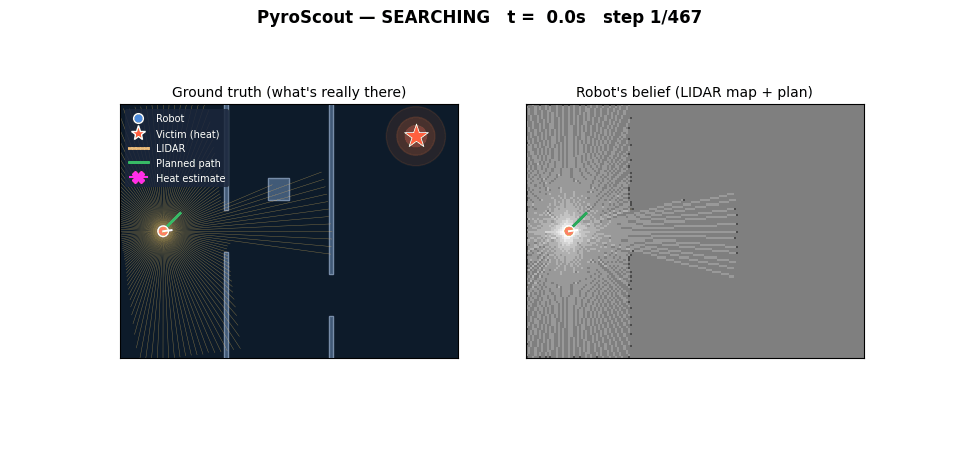
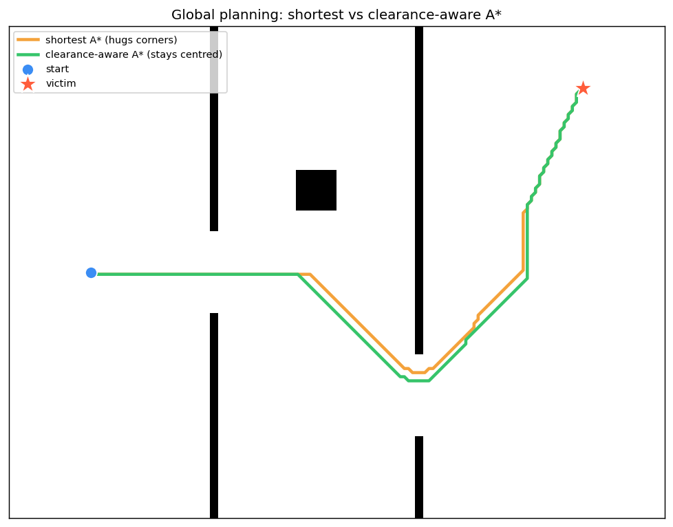

# PyroScout: thermal and LIDAR fusion for search-and-rescue

[](https://github.com/a-haz/pyroscout/actions/workflows/ci.yml)

PyroScout is a small 2D robotics simulator written from scratch in Python
(NumPy and Matplotlib). A differential-drive robot starts in a building it has
no map of and has to find a heat source (the "victim") using two sensors:

- a 2D LIDAR, used to build an occupancy grid map of the walls
- a thermal sensor, used to detect the victim and estimate where it is

The robot explores until the thermal sensor gets line of sight, then plans a
path to the estimated victim position and drives there. Everything runs in
simulation; there is no real hardware involved.

<p align="center">
  
</p>

Left: the true world (walls, a pillar, the heat source and the LIDAR beams).
Right: the occupancy grid the robot builds from LIDAR, with its current plan.

A longer walk-through with code and figures is in
[`notebooks/pyroscout_writeup.ipynb`](notebooks/pyroscout_writeup.ipynb).

## Results

These numbers come from `examples/run_search_rescue.py` and the scenario in
`pyroscout/scenarios.py`. The robot starts in the left room and the victim is in
the right room, behind two offset doorways, so it is not visible at the start.

Seed 0:

| Metric | Value |
|---|---|
| Outcome | victim reached |
| Wall collisions | 0 |
| Victim position error | 1.2 cm |
| Distance travelled | 25.1 m |
| Simulated time | 46.7 s |

Seeds 0 to 7 (different sensor noise): 8 of 8 runs reached the victim with 0
collisions. Position error ranged from 0.5 to 2.8 cm and distance travelled from
22.1 to 25.1 m.

## How it works

| Part | Module | What it does |
|---|---|---|
| Robot | [`robot.py`](pyroscout/robot.py) | differential-drive kinematics |
| LIDAR | [`sensors/lidar.py`](pyroscout/sensors/lidar.py) | ray casting against wall segments, with Gaussian noise |
| Thermal | [`sensors/thermal.py`](pyroscout/sensors/thermal.py) | inverse-square intensity, blocked by walls, noisy bearing and intensity |
| Mapping | [`mapping/occupancy_grid.py`](pyroscout/mapping/occupancy_grid.py) | log-odds occupancy grid, frontiers, inflated costmap, clearance map |
| Planning | [`planning/astar.py`](pyroscout/planning/astar.py) | A* on the grid, no corner cutting, extra cost near walls |
| Control | [`control/pure_pursuit.py`](pyroscout/control/pure_pursuit.py) | pure-pursuit path following |
| Behaviour | [`navigator.py`](pyroscout/navigator.py) | state machine that ties the parts together |

The thermal model is `measured = I0 / (d**2 + 1)`, so a reading can be turned
back into a range estimate with `d = sqrt(I0 / measured - 1)`. Combined with the
bearing, that gives a position estimate, which is smoothed over time.

The navigator has four states:

- `SEARCHING`: no thermal detection yet. Drive to frontiers (the edge between
  mapped free space and unknown space) to grow the map.
- `NAVIGATING`: the victim has been detected. Plan to the estimated position and
  replan as the map changes. If there is no path yet, explore toward it.
- `REACHED`: the robot is at the victim.
- `FAILED`: no frontiers left and the victim was not found.

A* uses a cost field that penalises cells close to walls, so paths go through
the middle of doorways instead of clipping corners:

<p align="center"></p>

## Running it

```bash
python -m pip install -e .[dev]

# demo run, writes assets/hero.png and assets/demo.gif
python examples/run_search_rescue.py            # options: --seed 3, --no-gif

# figures for the LIDAR scan and the planner comparison
python examples/demo_lidar.py
python examples/demo_planning.py

# tests (including one full run) and lint
pytest -q
ruff check .
```

From Python:

```python
from pyroscout.scenarios import demo_navigator

nav, world, robot = demo_navigator(seed=0)
result = nav.run(max_steps=700)
print(result.success, result.collisions, result.path_length)
```

## Layout

```
pyroscout/
  geometry.py              ray casting, angle helpers, poses
  world.py                 arena, rectangular obstacles, heat sources
  robot.py                 differential-drive kinematics
  sensors/lidar.py         2D LIDAR
  sensors/thermal.py       thermal sensor model
  mapping/occupancy_grid.py
  planning/astar.py
  control/pure_pursuit.py
  navigator.py             state machine and exploration
  viz.py                   plotting and GIF export
  scenarios.py             the demo world
examples/                  demo scripts that also produce the figures
tests/                     unit and integration tests
notebooks/                 write-up notebook
```

## Limitations

- Odometry is perfect, so there is no localisation problem (no SLAM).
- The world is static and 2D.
- One robot, one victim.

## License

MIT, see [LICENSE](LICENSE).
